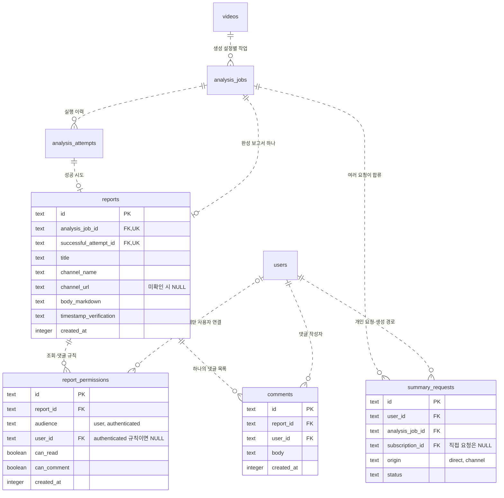
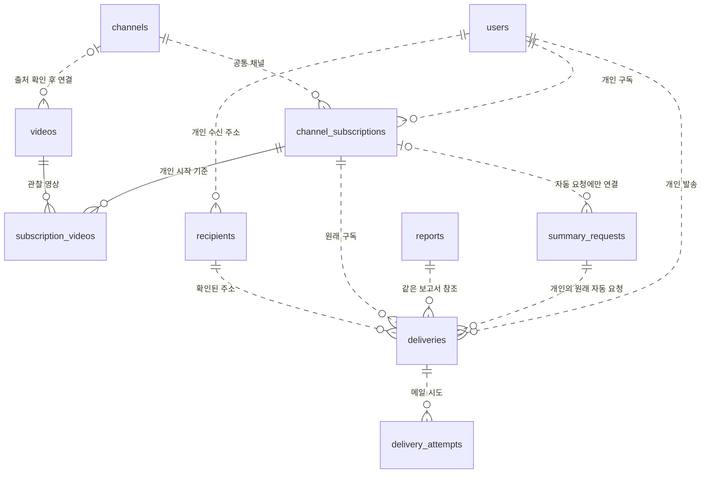
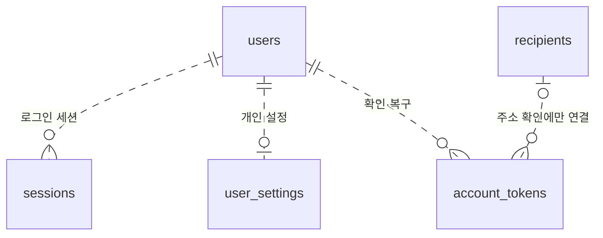

# 공통 보고서와 사용자별 접근 권한 ERD 수정안

상태는 **확정한 저장 설계**예요. [ADR-0020](decisions/0020-shared-analysis-and-report-permissions.md)의
관계를 구체화했어요. [D1 가이드](database.md)의 0003_shared_reports.sql에 적용했어요. 제품 HTTP 구현과 원격 적용은 별도예요.

같은 공개 영상·생성 설정에는 보고서 하나를 만들어요. A와 B의 보관함·댓글 조회는 동일한
`reports.id`를 사용해요. 사용자마다 보고서 행을 만드는 앞선 수정안은 철회해요.

17개 테이블·116개 열·27개 논리 관계를 포함한
[전체 ERD 원본](diagrams/qletter-full-erd-proposal.mmd)을 함께 관리해요.
아래 도식은 영역별 관계이고, 전체 원본에는 인증·설정·모든 핵심 열도 포함돼요.
PK는 기본키, FK는 외래키, UK는 단일 unique예요. 복합·부분 unique는 아래 설명을 따라요.
시간은 UTC Unix 초 `INTEGER`, 0/1 표시는 `INTEGER`이며 미확인·미완료 값은 `NULL`이에요.
영상 ID는 원본 YouTube video ID이고 나머지 외부 자원 ID는 UUID를 사용해요.

## 공통 보고서·접근 권한·댓글

`reports`에는 `user_id`, 개인 요청 ID, 개인 공개 상태를 두지 않아요. 보고서 본문도 이 테이블에
두므로 앞선 안의 `report_contents`와 사용자별 `reports` 이중 구조를 제거해요.
개인의 최초 요청·직접/자동 경로는 `summary_requests`, 접근·보관 관계는 `report_permissions`에 있어요.
요청 상태가 완료되면 해당 공통 작업의 보고서 ID를 반환해요. B에게 별도 보고서 ID를 만들지 않아요.

- `analysis_jobs`: `(video_id, generation_key)` unique. 생성 설정은 모델·API/영상 처리 방식·
  프롬프트 버전·언어·생성 옵션을 식별해요. 현재 생성 설정은 ADR-0017을 따라요.
- `reports`: `analysis_job_id` unique. 성공 시도는 동일한 작업이어야 해요. 본문은 불변이에요.
  새로운 생성 설정은 별도 작업·보고서이고 이전 보고서의 댓글과 본문은 유지해요.
- `summary_requests`: `(user_id, analysis_job_id)` unique. 개인 요청을 유지하면서 실행 중 작업에
  합류하거나 완성된 공통 보고서를 재사용해요. 개인 경로와 활동을 다른 사용자에게 보여주지 않아요.
- `report_permissions`: `audience=user`이면 user_id 필수, `authenticated`이면 user_id는 NULL이에요.
  개인 규칙은 `(report_id, user_id) WHERE audience='user'`, 공개 규칙은
  `(report_id) WHERE audience='authenticated'`에 각각 partial unique를 둬야 해요.
  NULL을 포함하는 일반 unique 하나로 공개 규칙 중복까지 막았다고 보지 않아요.
- `comments`: `report_id`를 FK로 사용해요. 같은 보고서를 보는 모든 사용자가 같은 댓글 목록을
  조회해요. 작성자 user_id는 댓글의 소유자를 뜻하며 닉네임만 응답해요. 본인 댓글만 삭제할 수 있어요.

## 보관함과 공개 규칙

개인이 요약을 요청하거나 자동 구독으로 보고서를 얻으면 본인 `audience=user` 조회 규칙을 저장해요.
내 보관함은 이 개인 규칙으로 공통 보고서를 조회해요. 공개된 보고서를 열어 보기만 했다고 모든
사용자의 보관함에 넣지 않아요. 공개 규칙을 사용자 수만큼 복제하지도 않아요.

| 규칙 | 적용 대상 | 역할 |
| --- | --- | --- |
| `user`, user_id=A | A | A의 개인 접근·보관 관계 |
| `user`, user_id=B | B | 같은 보고서에 대한 B의 개인 접근·보관 관계 |
| `authenticated`, user_id=NULL | 로그인 사용자 전체 | #23의 공개 조회·댓글 규칙 |

새 공통 보고서는 공개 규칙 없이 시작해요. 조회에는 본인의 read 권한 또는 로그인 사용자 전체의
read 규칙이 필요해요. #23의 비공개 댓글 금지 규칙을 유지하므로 개인 read 권한만으로는 댓글을
조회·작성하지 못해요. 공개 규칙이 댓글을 허용한 보고서에서만 댓글 조회·작성이 가능해요.

공개 목록·검색·댓글 수는 같은 공개 권한 판정 경로를 사용해야 해요. 내부 공통 보고서가 있다는
이유로 접근 권한 없는 계정에 본문·댓글·다른 사용자의 요청 이력을 보여주지 않아요.
보관 해제는 본인의 개인 관계만 제거하고 공통 보고서·다른 사람의 권한·댓글은 지우지 않아요.
개인 관계의 제거와 이후 동일 영상을 다시 요청했을 때의 재부여는 원자적으로 처리해야 해요.

**공개 규칙을 누가 변경할지는 미확정**이에요. 기존 #23의 '작성자만 공개/비공개 전환'은
사용자마다 독립 보고서를 만든다는 전제였어요. 하나의 시스템 생성 보고서를 공유하는 모델에서는
최초 요청자에게 다른 사용자의 댓글 접근까지 철회할 권한을 자동으로 주지 않아요.
공개 관리 주체와 비공개 전환 시 댓글 보존·삭제 정책을 정한 뒤 API·명세를 맞춰야 해요.

## 구독과 발송

채널 하나에 여러 사용자 구독이 붙어요. 활성 구독은 `(user_id, channel_id)`당 하나이고,
시작 기준·주기·중지·삭제는 개인별이에요. B의 등록 후 첫 성공한 영상 집합으로 B의 기준을 정하며
A의 과거 보관함을 B에게 소급 생성·발송하지 않아요. 빈 채널의 기준 완료도 기록해요.

A의 직접 요약과 B의 자동 요약이 같은 보고서를 참조해도 B의 확인된 주소에만 자동 메일을 만들어요.
`deliveries`는 개인 request_id·user_id·subscription_id·recipient_id와 공통 report_id를 연결해요.
요청·구독·주소는 같은 사용자이고, 보고서는 그 요청의 공통 분석 작업 결과여야 해요.
공통 보고서에 사용자 소유 FK를 거는 방식은 사용하지 않아요.

발송 중복 키도 `(user_id, report_id, recipient_id)`와 `(user_id, report_id, recipient_email)`이에요.
공통 report_id만 사용한 전역 주소 중복 제한이 다른 계정의 발송까지 막지 않게 해요.
메일 실패는 저장한 보고서를 다시 보내며 영상을 재분석하지 않아요. A의 구독 중지·보관 해제가
B의 권한·구독·발송이나 공통 보고서·댓글을 삭제하면 안 돼요.

## 전체 테이블과 검증 범위

논리 모델은 아래 17개 테이블이에요. 인증·수신 주소의 기존 토큰 hash·소유권·만료 규칙은 유지해요.

| 테이블 | 연결·역할 | 핵심 중복 방지 |
| --- | --- | --- |
| `users` | 계정·닉네임·이메일 확인 | 정규화 이메일 unique |
| `sessions` | 사용자별 로그인 세션·만료 | token_hash unique |
| `account_tokens` | 계정 확인·복구, 수신 주소 확인 때만 recipient 연결 | token_hash unique |
| `user_settings` | 사용자별 채널 확인 주기 | user_id PK·FK |
| `channels` | 모든 사용자가 참조하는 공통 채널 | youtube_channel_id unique |
| `videos` | 공통 영상, 출처 확인 후 channel 연결 | 원본 video ID PK |
| `channel_subscriptions` | 사용자와 공통 채널, 개인 중지·삭제·시작 기준 | 활성 `(user_id, channel_id)` unique |
| `subscription_videos` | 구독별 기준 영상·발견 기록 | `(subscription_id, video_id)` PK |
| `analysis_jobs` | 공통 영상·불변 생성 설정의 분석 작업 | `(video_id, generation_key)` unique |
| `analysis_attempts` | 공통 작업의 분석 실행 이력 | `(analysis_job_id, attempt_number)` unique |
| `summary_requests` | 사용자별 요청·직접/자동 경로·원래 구독 | `(user_id, analysis_job_id)` unique |
| `reports` | 공통 본문·출처·성공 시도·같은 댓글의 기준 ID | analysis_job_id·successful_attempt_id 각각 unique |
| `report_permissions` | 사용자 보관·접근 관계와 로그인 사용자 전체 공개 규칙 | 개인·공개 규칙의 partial unique |
| `comments` | 공통 report_id와 댓글 작성 사용자 | 댓글 ID PK |
| `recipients` | 사용자별 확인된 메일 주소 | 활성 `(user_id, email)` unique |
| `deliveries` | 공통 보고서와 개인 자동 요청·구독·주소·발송 상태 | 사용자·보고서·주소 기준 unique |
| `delivery_attempts` | 개인 발송의 SMTP 실행 이력 | `(delivery_id, attempt_number)` unique |

전체 원본의 선은 논리 FK 관계를 표현해요. 보고서와 성공 시도의 작업 일치, 자동 요청·구독·주소의
사용자 일치, 발송 보고서와 개인 요청의 작업 일치도 저장 제약으로 검증해야 해요.
한 줄짜리 선만으로 이런 복합 조건을 모두 구현한 것은 아니에요. 세션·토큰의 원문을 저장하지 않으며,
메일 시도의 사용자 소유권은 부모 `deliveries`에서 판정해요.

모음 #24는 사용자·공통 report_id를 연결하고 본인의 보관 관계를 확인하도록 후속 구현해요.
여기에는 모든 운영 열·FK를 나열하지 않았어요. SDK 재시도·응답 유실까지 포함한 외부 호출의
정확히 한 번 실행을 보장하지 않으며 결과 불명 이력·재호출 방지 규칙이 필요해요.

아래 저장 동작은 workerd·로컬 D1 회귀 검사 대상이에요. 실제 인증·제품 HTTP 성공과 구분해요.

- A·B 동일 입력이 작업 1개, 보고서 1개, 개인 요청·접근 관계 각 2개로 이어져요.
- A·B 보고서 상세와 댓글 API가 같은 report_id를 사용해요. B 댓글을 A가 같은 목록에서 볼 수 있어요.
- 본문·댓글 조회와 작성 전에 권한을 검사하고, 비공개 댓글 접근은 거부해요.
- A의 보관 해제·중지·삭제가 B와 공통 보고서·댓글을 손상하지 않아요.
- 같은 보고서를 사용하는 A 직접 요청·B 자동 요청은 B에게만 메일을 만들어요.

이 문서는 확정 설계예요. 실제 저장 제약과 검증·복구 절차는 #8에서 기록하고 인증·HTTP·원격 동작과 구분해요.
